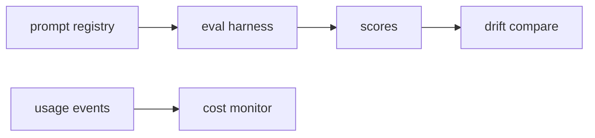

# SAMPLE: LLM ops toolkit

> Illustrative sample by Kunjar Bhaduri. Prompts, scores and prices are fixtures. No client, no employer, and no hosted model. Built by AI coding tools under my direction. October 2026 (America/Chicago).

This library keeps an immutable prompt registry, scores a prompt against cases, compares two score windows for drift, and totals token cost against a budget. The responder is injected. The built-in responder only fills `{slots}`. CI never calls a model API.

## Architecture



`add` stores the template and never edits it. A repeated template returns the existing version. `promote` moves the active pointer. The harness asks the responder for an output, then scores exact, contains, or token F1. Drift uses a binned population-stability index plus the change in mean. Cost uses a sample price table.

## Run

Python 3.10 or newer. Standard library only. From this repository:

```bash
python3 -m llmops.demo
python3 -m unittest discover -s tests -v
```

The CI workflow repeats both commands.

## Decisions

- Versions are frozen dataclasses so a test can prove promotion does not rewrite history.
- The responder is an argument so a later swap to a real model client does not change the harness.
- Drift bins span the combined min and max. PSI is 0 when every score in both windows is the same value. Empty bins use a 0.001 floor before the shares are normalized, so the log is defined.

## Limits

Slot filling is not a language model. The price table (`sample-local` at 2 dollars per million input tokens, `sample-large` at 15 dollars per million input tokens) is a fixture, not a bill. PSI on four scores is a teaching metric, not a production pager. There is no claim this watched a live application.
